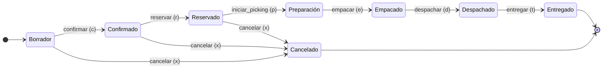
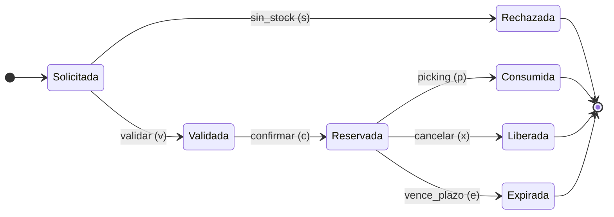
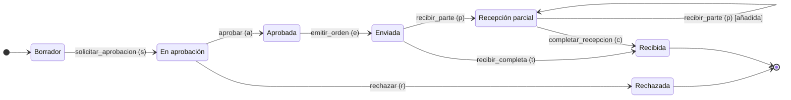

# Fase A · Autómatas de pedido, reserva y orden de compra

| Campo | Valor |
|---|---|
| **Fase / historias** | A-01, A-02, A-03 (autómatas) y A-04 (secuencias) · Sprint 1–2 |
| **Responsable / revisor** | Elias (@elorgus) / Richard (@RichJ-100) |
| **Modelos JFLAP** | `modelos/pedido.jff` · `modelos/reserva.jff` · `modelos/orden_compra.jff` |
| **Código** | `src/fase_a_automatas.py` |
| **Pruebas** | `tests/test_fase_a_automatas.py` (30 pruebas) |
| **Estado** | Revisado |

## 0. Convenciones y supuestos (declarados, no escondidos)

| # | Supuesto / decisión | Por qué |
|---|---|---|
| S1 | Cada modelo es un **AFD parcial** `M = (Q, Σ, q₀, F, δ)` con `δ: Q × Σ ⇀ Q`. Si `(q, e) ∉ dom δ`, el evento es **imposible** en `q` y la secuencia se rechaza. | El deber pide «evitar transiciones imposibles». Un AFD parcial equivale a uno completo con un estado trampa implícito; no lo dibujamos para no ensuciar el modelo. JFLAP rechaza igual. |
| S2 | **F = estados que cierran el ciclo de vida (sumideros, sin transiciones salientes).** «Final» ≠ «éxito»: `Rechazada`, `Liberada`, `Expirada` y `Cancelado` son finales sin éxito. | Coherente con el deber («un estado final rechazado no habilita emisión»: `Rechazada` es final **y** no permite nada después). |
| S3 | **⚠ Ambigüedad de la Figura 2:** `Cancelado` está dibujado con círculo simple (no final), a diferencia de `Rechazada`/`Liberada`/`Expirada` de las Figuras 3 y 4, que sí son dobles. **Lectura propuesta: `Cancelado ∈ F`.** | Con `F = {Entregado}` una cancelación legítima (`Borrador → Cancelado`) sería «rechazada» por el autómata, igual que un error. Si el equipo prefiere seguir la figura al pie de la letra, el cambio es mínimo (ver §1.4). |
| S4 | En la Figura 2 la arista `Reservado → Cancelado` dice «liberar/cancelar». La modelamos como **un solo evento `cancelar`**; «liberar» es el efecto sobre la reserva, no otro símbolo. | Dos etiquetas en una misma arista serían dos símbolos con el mismo efecto en `δ`: redundante. |
| S5 | Los tres autómatas son **independientes** (no se modela el producto). Los acoplamientos se documentan: `reservar` del pedido ⇔ la reserva llegó a `Reservada`; `iniciar_picking` del pedido ⇔ evento `picking` de la reserva (`Consumida`); `cancelar` del pedido en `Reservado` ⇔ `cancelar` de la reserva (`Liberada`). | El deber pide tres modelos; el producto sería un cuarto modelo. |
| S6 | En JFLAP cada evento se teclea como **una sola letra** (tabla de Σ de cada autómata). El `.jff` usa letras; este documento y el código usan los nombres de los eventos. | JFLAP consume la entrada carácter a carácter: etiquetas largas se leerían como cadenas, no como eventos. |
| S7 | Hay tres veredictos: **ACEPTADA** (termina en F), **RECHAZADA_TRANSICION** (algún evento no tiene `δ`: *secuencia inválida*) y **RECHAZADA_NO_FINAL** (todas las transiciones existen pero se termina fuera de F: *válida pero incompleta*). En JFLAP los dos últimos se ven como «Reject». | «Inválida» del deber = transición imposible. Una secuencia que simplemente no ha terminado no es un error: es un ciclo en curso. |

**Problema que resuelve cada autómata (decisión):** `L(M) = { w ∈ Σ* : δ̂(q₀, w) está definido y ∈ F }`, es decir, «¿esta secuencia de eventos es un ciclo de vida completo y permitido?». Es un lenguaje regular; se decide en **`O(|w|)` tiempo** leyendo una vez la secuencia (modelo: AFD, que una máquina de Turing determinista simula en una pasada), así que está en P y es decidible (siempre termina: consume `|w|` símbolos y se detiene).

---

## 1. Autómata del pedido (Figura 2)

**Q** (8) = {Borrador, Confirmado, Reservado, Preparación, Empacado, Despachado, Entregado, Cancelado}
**q₀** = Borrador · **F** = {Entregado, Cancelado} · |δ| = 9

| Evento (Σ) | Letra | Significado |
|---|---|---|
| `confirmar` | c | el cliente/ventas confirma el pedido |
| `reservar` | r | se reserva inventario para el pedido |
| `iniciar_picking` | p | bodega comienza a recoger (consume la reserva) |
| `empacar` | e | termina el empaque |
| `despachar` | d | sale de la planta |
| `entregar` | t | entrega al cliente |
| `cancelar` | x | cancelación (libera la reserva si existe) |

### 1.1 Tabla de transiciones δ (`—` = evento imposible en ese estado)
| Estado \ Evento | confirmar | reservar | iniciar_picking | empacar | despachar | entregar | cancelar |
|---|---|---|---|---|---|---|---|
| → **Borrador** | Confirmado | — | — | — | — | — | Cancelado |
| **Confirmado** | — | Reservado | — | — | — | — | Cancelado |
| **Reservado** | — | — | Preparación | — | — | — | Cancelado |
| **Preparación** | — | — | — | Empacado | — | — | — |
| **Empacado** | — | — | — | — | Despachado | — | — |
| **Despachado** | — | — | — | — | — | Entregado | — |
| \* **Entregado** | — | — | — | — | — | — | — |
| \* **Cancelado** | — | — | — | — | — | — | — |



### 1.2 Justificación de los estados finales
- **Entregado**: fin exitoso; no hay más eventos del pedido.
- **Cancelado**: fin sin éxito, pero el ciclo quedó **cerrado de forma legítima**; no admite eventos posteriores (no se puede entregar un pedido cancelado).
- **No son finales** `Empacado` ni `Despachado`: el pedido aún no llegó al cliente; aceptarlos daría por bueno un ciclo incompleto (secuencia `P-N1`).

### 1.3 Qué se tomó de la figura y qué se decidió
- Se conservan los 8 estados y las 9 aristas de la Figura 2 (6 del flujo + 3 de cancelación). **No se añadió ninguna transición.**
- **Decisión de modelado (omisión intencional):** no hay `cancelar` desde `Preparación`, `Empacado` ni `Despachado`. Tras `iniciar_picking` la reserva ya está `Consumida` (autómata de reserva): no queda nada que liberar, y devolver mercadería sería otro proceso (devoluciones) que el deber no pide.
- **Σ formal:** los 7 eventos de la tabla; «liberar/cancelar» → `cancelar` (S4).

### 1.4 Si el equipo decide seguir la figura al pie de la letra (`F = {Entregado}`)
Tres cambios: (1) en JFLAP, quitar «Final» a `Cancelado`; (2) en `PEDIDO.finales` dejar solo `Entregado`; (3) las secuencias `P-V2` y `P-V3` pasan de ACEPTADA a RECHAZADA_NO_FINAL y fallan varias pruebas (las que recorren `CASOS` y `test_F_es_exactamente_el_conjunto_de_sumideros`), que hay que actualizar.

### 1.5 Secuencias (≥2 válidas y ≥2 inválidas) y la transición que decide
| Id | Secuencia de eventos | JFLAP | Veredicto | Transición que acepta / rechaza |
|---|---|---|---|---|
| P-V1 | confirmar, reservar, iniciar_picking, empacar, despachar, entregar | `crpedt` | **ACEPTADA** (prueba del deber) | termina en `Entregado ∈ F` por δ(Despachado, entregar) |
| P-V2 | confirmar, reservar, cancelar | `crx` | **ACEPTADA** | δ(Reservado, cancelar) = Cancelado ∈ F |
| P-V3 | cancelar | `x` | **ACEPTADA** | δ(Borrador, cancelar) = Cancelado ∈ F |
| P-I1 | despachar | `d` | **RECHAZADA** (prueba del deber: Borrador→Despachado) | δ(Borrador, despachar) **no definida** |
| P-I2 | confirmar, reservar, iniciar_picking, cancelar | `crpx` | **RECHAZADA** | δ(Preparación, cancelar) **no definida** |
| P-I3 | …, despachar, entregar, cancelar | `crpedtx` | **RECHAZADA** | δ(Entregado, cancelar) **no definida** (sumidero) |
| P-I4 | confirmar, empacar | `ce` | **RECHAZADA** | δ(Confirmado, empacar) **no definida** (se salta reservar y picking) |
| P-N1 | confirmar, reservar, iniciar_picking, empacar | `crpe` | **RECHAZADA** (incompleta) | todas las δ existen, pero termina en `Empacado ∉ F` |

---

## 2. Autómata de la reserva (Figura 3)

**Q** (7) = {Solicitada, Validada, Rechazada, Reservada, Consumida, Liberada, Expirada}
**q₀** = Solicitada · **F** = {Rechazada, Consumida, Liberada, Expirada} · |δ| = 6

| Evento (Σ) | Letra | Significado |
|---|---|---|
| `validar` | v | la solicitud pasa la validación (hay stock disponible) |
| `sin_stock` | s | no hay stock: se rechaza |
| `confirmar` | c | se confirma y se **retiene** stock |
| `picking` | p | el picking consume lo reservado |
| `cancelar` | x | se cancela y se libera lo retenido |
| `vence_plazo` | e | vence el plazo de la reserva |

### 2.1 Tabla de transiciones δ
| Estado \ Evento | validar | sin_stock | confirmar | picking | cancelar | vence_plazo |
|---|---|---|---|---|---|---|
| → **Solicitada** | Validada | Rechazada | — | — | — | — |
| **Validada** | — | — | Reservada | — | — | — |
| **Reservada** | — | — | — | Consumida | Liberada | Expirada |
| \* **Rechazada** | — | — | — | — | — | — |
| \* **Consumida** | — | — | — | — | — | — |
| \* **Liberada** | — | — | — | — | — | — |
| \* **Expirada** | — | — | — | — | — | — |



### 2.2 Justificación de los estados finales
Los cuatro son **sumideros**: cada uno cierra la reserva de una forma distinta (`Consumida` = se usó; `Liberada` = se canceló; `Expirada` = venció; `Rechazada` = nunca hubo stock). `Solicitada`, `Validada` y `Reservada` no son finales porque la reserva sigue abierta.

### 2.3 Qué se tomó de la figura y qué se decidió
- Se conservan los 7 estados y las 6 aristas de la Figura 3. **No se añadió ninguna transición.**
- **Cómo se evita «consumir una reserva que nunca fue confirmada»:** `picking`, `cancelar` y `vence_plazo` solo existen desde `Reservada`, y a `Reservada` solo se llega con `confirmar` desde `Validada`. Por eso `validar, picking` (R-I1) y `picking` (R-I2) no tienen transición.
- **Supuesto:** solo `Reservada` retiene stock. Por eso `Validada` no puede cancelarse ni expirar en este modelo (no hay stock que liberar). Si el negocio quiere «abandonar» solicitudes validadas, se añadiría `Validada --cancelar--> Liberada`; no está en la figura y no lo añadimos.

### 2.4 Secuencias
| Id | Secuencia de eventos | JFLAP | Veredicto | Transición que acepta / rechaza |
|---|---|---|---|---|
| R-V1 | validar, confirmar, picking | `vcp` | **ACEPTADA** (prueba del deber) | δ(Reservada, picking) = Consumida ∈ F |
| R-V2 | validar, confirmar, cancelar | `vcx` | **ACEPTADA** | δ(Reservada, cancelar) = Liberada ∈ F |
| R-V3 | validar, confirmar, vence_plazo | `vce` | **ACEPTADA** | δ(Reservada, vence_plazo) = Expirada ∈ F |
| R-V4 | sin_stock | `s` | **ACEPTADA** | δ(Solicitada, sin_stock) = Rechazada ∈ F |
| R-I1 | validar, picking | `vp` | **RECHAZADA** (consumir sin confirmar) | δ(Validada, picking) **no definida** |
| R-I2 | picking | `p` | **RECHAZADA** | δ(Solicitada, picking) **no definida** |
| R-I3 | sin_stock, validar | `sv` | **RECHAZADA** | δ(Rechazada, validar) **no definida** (sumidero) |
| R-I4 | validar, confirmar, picking, cancelar | `vcpx` | **RECHAZADA** | δ(Consumida, cancelar) **no definida** |
| R-N1 | validar, confirmar | `vc` | **RECHAZADA** (incompleta) | termina en `Reservada ∉ F` |

---

## 3. Autómata de la orden de compra (Figura 4)

**Q** (7) = {Borrador, En aprobación, Aprobada, Rechazada, Enviada, Recepción parcial, Recibida}
**q₀** = Borrador · **F** = {Rechazada, Recibida} · |δ| = 8 (7 de la figura + 1 añadida)

| Evento (Σ) | Letra | Significado |
|---|---|---|
| `solicitar_aprobacion` | s | se envía a aprobación |
| `aprobar` | a | el aprobador acepta |
| `rechazar` | r | el aprobador rechaza |
| `emitir_orden` | e | se emite la orden al proveedor |
| `recibir_parte` | p | llega una parte del pedido |
| `completar_recepcion` | c | llega lo que faltaba tras recepciones parciales |
| `recibir_completa` | t | llega todo de una vez |

### 3.1 Tabla de transiciones δ
| Estado \ Evento | solicitar_aprobacion | aprobar | rechazar | emitir_orden | recibir_parte | completar_recepcion | recibir_completa |
|---|---|---|---|---|---|---|---|
| → **Borrador** | En aprobación | — | — | — | — | — | — |
| **En aprobación** | — | Aprobada | Rechazada | — | — | — | — |
| **Aprobada** | — | — | — | Enviada | — | — | — |
| **Enviada** | — | — | — | — | Recepción parcial | — | Recibida |
| **Recepción parcial** | — | — | — | — | **Recepción parcial** *(añadida)* | Recibida | — |
| \* **Rechazada** | — | — | — | — | — | — | — |
| \* **Recibida** | — | — | — | — | — | — | — |



### 3.2 Justificación de los estados finales
- **Recibida**: la orden se cumplió; ciclo cerrado con éxito.
- **Rechazada**: ciclo cerrado sin éxito y **sumidero**: no habilita `emitir_orden` ni nada más (prueba `O-I1` del deber).
- **No son finales** `Aprobada` (aún no se pidió al proveedor), `Enviada` ni `Recepción parcial` (falta mercadería).

### 3.3 Qué se tomó de la figura y qué se completó
- Se conservan los 7 estados y las 7 aristas de la Figura 4.
- **Única adición: bucle `Recepción parcial --recibir_parte--> Recepción parcial`.** En la figura, `Recepción parcial` solo tiene `completar_recepcion`, o sea que una orden podría tener a lo sumo **una** entrega parcial; el proveedor real puede entregar en varios lotes (`O-V3`). Es una adición que no crea ninguna transición imposible. Si el equipo la rechaza, se borra esa arista y `O-V3` pasa a RECHAZADA.
- **Decisión de modelado (omisión intencional):** no hay `cancelar` en `Borrador`/`Aprobada`, porque la figura no lo dibuja y el deber no pide cancelación de compras.
- `completar_recepcion` y `recibir_completa` llegan ambos a `Recibida` y se mantienen como **eventos distintos**: uno cierra tras recepciones parciales, el otro es una recepción total directa.

### 3.4 Secuencias
| Id | Secuencia de eventos | JFLAP | Veredicto | Transición que acepta / rechaza |
|---|---|---|---|---|
| O-V1 | solicitar_aprobacion, aprobar, emitir_orden, recibir_completa | `saet` | **ACEPTADA** | δ(Enviada, recibir_completa) = Recibida ∈ F |
| O-V2 | …, emitir_orden, recibir_parte, completar_recepcion | `saepc` | **ACEPTADA** | δ(Recepción parcial, completar_recepcion) = Recibida ∈ F |
| O-V3 | …, emitir_orden, recibir_parte, recibir_parte, completar_recepcion | `saeppc` | **ACEPTADA** | usa el bucle añadido; cierra en `Recibida` |
| O-V4 | solicitar_aprobacion, rechazar | `sr` | **ACEPTADA** | δ(En aprobación, rechazar) = Rechazada ∈ F |
| O-I1 | solicitar_aprobacion, rechazar, emitir_orden | `sre` | **RECHAZADA** (prueba del deber: Rechazada→Enviada) | δ(Rechazada, emitir_orden) **no definida** |
| O-I2 | emitir_orden | `e` | **RECHAZADA** | δ(Borrador, emitir_orden) **no definida** |
| O-I3 | solicitar_aprobacion, emitir_orden | `se` | **RECHAZADA** | δ(En aprobación, emitir_orden) **no definida** |
| O-I4 | …, recibir_completa, recibir_parte | `saetp` | **RECHAZADA** | δ(Recibida, recibir_parte) **no definida** |
| O-N1 | …, emitir_orden, recibir_parte | `saep` | **RECHAZADA** (incompleta) | termina en `Recepción parcial ∉ F` |

---

## 4. Cómo probar los `.jff` en JFLAP
1. `File → Open` y elegir el `.jff`. Debe aparecer como *Finite Automaton*.
2. `Input → Multiple Run`: pegar las cadenas de la tabla (una por fila) y pulsar *Run Inputs*. La columna *Result* debe coincidir con «Esperado».
3. Para ver el recorrido: `Input → Step…` con la cadena; JFLAP resalta el estado actual. Si no hay arista para la siguiente letra, se detiene y muestra *Reject*.
4. `Test → Highlight Nondeterminism` no debe marcar nada (los tres son deterministas).

| Autómata | Cadena | Esperado | Motivo |
|---|---|---|---|
| pedido | `crpedt` · `crx` · `x` | Accept | ciclo completo / cancelaciones permitidas |
| pedido | `d` · `crpx` · `crpedtx` · `ce` | Reject | transición imposible |
| pedido | `crpe` · (vacía) | Reject | termina fuera de F |
| reserva | `vcp` · `vcx` · `vce` · `s` | Accept | |
| reserva | `vp` · `p` · `sv` · `vcpx` | Reject | transición imposible |
| reserva | `vc` · (vacía) | Reject | termina fuera de F |
| orden_compra | `saet` · `saepc` · `saeppc` · `sr` | Accept | |
| orden_compra | `sre` · `e` · `se` · `saetp` | Reject | transición imposible |
| orden_compra | `saep` · (vacía) | Reject | termina fuera de F |

> **Verificación realizada:** (1) el XML de cada `.jff` está bien formado y sigue la estructura estándar `type=fa` de JFLAP; (2) el código relee cada `.jff` y simula las 26 secuencias sobre él, con el mismo resultado que sobre la definición (`PruebasJFLAP`); (3) los tres `.jff` se cargaron en un simulador en línea compatible con JFLAP y los diagramas obtenidos coinciden con las tablas δ (capturas adjuntas al PR). **Limitación:** no se usó el programa JFLAP de escritorio.
---

## 5. Implementación, pruebas y salida observada
Separación: datos (`PEDIDO`, `RESERVA`, `ORDEN_COMPRA`, `CASOS`), validación (`validar_automata`), procesamiento (`ejecutar`, `alcanzables`, `coalcanzables`, `sumideros`), JFLAP (`a_jff`, `leer_jff`), presentación (`main`). `ejecutar` distingue **entrada inválida** (`ValueError`/`TypeError`: evento fuera de Σ, secuencia que es una cadena) de **rechazo del modelo** (veredicto).

| Tipo | Caso | Resultado esperado |
|---|---|---|
| Normal | las 4 pruebas mínimas del deber | aceptada / rechazada según §1–§3 |
| Normal | 26 secuencias documentadas (≥2 válidas y ≥2 inválidas por autómata) | veredicto y transición de bloqueo exactos |
| Límite | secuencia vacía | RECHAZADA_NO_FINAL (q₀ ∉ F) |
| Límite | 10 000 `recibir_parte` seguidos + `completar_recepcion` | ACEPTADA (el bucle no rompe nada) |
| Límite | evento imposible seguido de más eventos | se detiene en el primero |
| Inválido | evento de otro autómata (`sin_stock` en pedido) | `ValueError` |
| Inválido | secuencia como `str`, `None`, o con elementos no textuales | `TypeError` |
| Inválido | definición mal formada (q₀ ∉ Q, F ⊄ Q, δ a estado inexistente, letras repetidas) | `ValueError` |
| Estructural | todo estado alcanzable desde q₀ y desde todo estado se llega a F; F = sumideros | se cumple en los 3 |
| JFLAP | cada `.jff` releído = definición del código; mismos veredictos | se cumple |

**Reproducir**
```bash
python3 src/fase_a_automatas.py                  # tablas y secuencias
python3 src/fase_a_automatas.py --jff modelos    # regenera los .jff
python3 -m unittest tests.test_fase_a_automatas -v   # las 30 pruebas de esta fase
```
**Salida observada** (`python3 src/fase_a_automatas.py`, recortada a las secuencias; `OK` = veredicto = esperado)
```
OK P-V1  crpedt   ACEPTADA              Borrador -> Confirmado -> Reservado -> Preparación -> Empacado -> Despachado -> Entregado
OK P-V2  crx      ACEPTADA              Borrador -> Confirmado -> Reservado -> Cancelado
OK P-V3  x        ACEPTADA              Borrador -> Cancelado
OK P-I1  d        RECHAZADA_TRANSICION  Borrador  bloqueo en δ('Borrador', 'despachar')
OK P-I2  crpx     RECHAZADA_TRANSICION  Borrador -> Confirmado -> Reservado -> Preparación  bloqueo en δ('Preparación', 'cancelar')
OK P-I3  crpedtx  RECHAZADA_TRANSICION  Borrador -> Confirmado -> Reservado -> Preparación -> Empacado -> Despachado -> Entregado  bloqueo en δ('Entregado', 'cancelar')
OK P-I4  ce       RECHAZADA_TRANSICION  Borrador -> Confirmado  bloqueo en δ('Confirmado', 'empacar')
OK P-N1  crpe     RECHAZADA_NO_FINAL    Borrador -> Confirmado -> Reservado -> Preparación -> Empacado
OK R-V1  vcp      ACEPTADA              Solicitada -> Validada -> Reservada -> Consumida
OK R-V2  vcx      ACEPTADA              Solicitada -> Validada -> Reservada -> Liberada
OK R-V3  vce      ACEPTADA              Solicitada -> Validada -> Reservada -> Expirada
OK R-V4  s        ACEPTADA              Solicitada -> Rechazada
OK R-I1  vp       RECHAZADA_TRANSICION  Solicitada -> Validada  bloqueo en δ('Validada', 'picking')
OK R-I2  p        RECHAZADA_TRANSICION  Solicitada  bloqueo en δ('Solicitada', 'picking')
OK R-I3  sv       RECHAZADA_TRANSICION  Solicitada -> Rechazada  bloqueo en δ('Rechazada', 'validar')
OK R-I4  vcpx     RECHAZADA_TRANSICION  Solicitada -> Validada -> Reservada -> Consumida  bloqueo en δ('Consumida', 'cancelar')
OK R-N1  vc       RECHAZADA_NO_FINAL    Solicitada -> Validada -> Reservada
OK O-V1  saet     ACEPTADA              Borrador -> En aprobación -> Aprobada -> Enviada -> Recibida
OK O-V2  saepc    ACEPTADA              Borrador -> En aprobación -> Aprobada -> Enviada -> Recepción parcial -> Recibida
OK O-V3  saeppc   ACEPTADA              Borrador -> En aprobación -> Aprobada -> Enviada -> Recepción parcial -> Recepción parcial -> Recibida
OK O-V4  sr       ACEPTADA              Borrador -> En aprobación -> Rechazada
OK O-I1  sre      RECHAZADA_TRANSICION  Borrador -> En aprobación -> Rechazada  bloqueo en δ('Rechazada', 'emitir_orden')
OK O-I2  e        RECHAZADA_TRANSICION  Borrador  bloqueo en δ('Borrador', 'emitir_orden')
OK O-I3  se       RECHAZADA_TRANSICION  Borrador -> En aprobación  bloqueo en δ('En aprobación', 'emitir_orden')
OK O-I4  saetp    RECHAZADA_TRANSICION  Borrador -> En aprobación -> Aprobada -> Enviada -> Recibida  bloqueo en δ('Recibida', 'recibir_parte')
OK O-N1  saep     RECHAZADA_NO_FINAL    Borrador -> En aprobación -> Aprobada -> Enviada -> Recepción parcial
```
`python3 -m unittest tests.test_fase_a_automatas` → `Ran 30 tests ... OK`.

## 6. Conclusión
Los tres procesos quedan como AFD parciales con **F = estados que cierran el ciclo**; las cuatro pruebas mínimas del deber se reproducen y cada autómata tiene ≥2 secuencias válidas y ≥2 inválidas con su transición decisiva. Las dos decisiones que el equipo debe confirmar son **S3** (`Cancelado ∈ F`) y la **arista añadida** de `Recepción parcial`. Los autómatas conectan con la Fase D: «¿es válida esta secuencia?» es un problema en P (tiempo lineal), contraste útil con los problemas B y C, donde verificar es barato pero encontrar no.

## Guía para exponer (≈2 min)
1. **Qué es un autómata aquí (20 s):** estados = etapas del negocio; Σ = eventos; δ = qué evento se permite en cada etapa; F = ciclo cerrado.
2. **Un ejemplo (40 s):** `Borrador → Despachado` se rechaza porque `δ(Borrador, despachar)` no existe; el pedido real debe pasar por confirmar, reservar, picking y empacar.
3. **Idea clave (30 s):** «final» no es «éxito» (`Rechazada` es final y no habilita emitir). Los finales son sumideros.
4. **Decisiones y límites (30 s):** `Cancelado` final (la figura no lo marca); bucle añadido en recepciones; autómatas independientes, sin modelar el producto.
5. **Conexión con el curso:** pertenencia al lenguaje = `O(|w|)`, decidible y en P.

## Lista de verificación (de `PLANTILLA_FICHA.md`, adaptada a la Fase A)
- [x] No se cambian las condiciones del deber: se usan los estados de las Figuras 2–4, las 4 pruebas mínimas tal cual, y lo añadido/decidido está declarado (S3, S4, bucle de `Recepción parcial`).
- [x] Se dice que el problema es de **decisión** (`w ∈ L(M)`?).
- [x] Etiqueta sostenida con la evidencia que corresponde: pertenencia en `O(|w|)` ⇒ P (no es un correo del grupo B ni C).
- [x] No se escribe «NP = no polinómico» (no aplica en esta fase).
- [x] Modelo de cómputo nombrado (AFD / MT determinista) y terminación justificada (`|w|` pasos).
- [x] Variables de complejidad definidas (`|w|`); aquí no hay valor-vs-bits porque Σ es finito.
- [x] El código valida entradas y separa lectura/procesamiento/presentación.
- [x] Pruebas normales, límite e inválidas; **salida observada real** (ejecutada en esta sesión).
- [ ] Revisión por pares (Richard): pendiente; **además**, los .jff ya se cargaron en un simulador en línea (§4).
