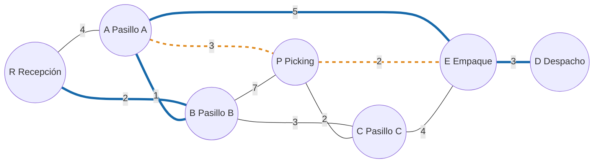

# Fase B · Grafo de la planta y búsqueda de rutas (Dijkstra)

| Campo | Valor |
|---|---|
| **Historias del backlog** | B-01 (grafo de planta), B-02 (pseudocódigo, terminación y Big-O), B-03 (implementación y pruebas) |
| **Sprint** | 1 (B-01) · 2 (B-02, B-03) |
| **Responsable / revisor** | Joshua (@joshdavr) / Elias (@elorgus) |
| **Código** | `src/dijkstra.py` (compartido con la ficha P2) |
| **Pruebas** | `tests/test_dijkstra.py` (19 pruebas) |
| **Estado** | Borrador v0.1 — pendiente de revisión por pares |

## 1. Modelo de la planta como grafo ponderado
Se usa el grafo de la **Figura 5 del enunciado** (planta con distancias en metros), sin cambiar nodos ni pesos.

- **Vértices `V`** (7 zonas o ubicaciones transitables): `R` Recepción, `A` Pasillo A, `B` Pasillo B, `C` Pasillo C, `P` Picking, `E` Empaque, `D` Despacho.
- **Aristas `E`** (11 pasillos) con peso = distancia en metros, todos **no negativos**:

| Pasillo | Peso (m) | Pasillo | Peso (m) | Pasillo | Peso (m) |
|---|---|---|---|---|---|
| R – A | 4 | A – P | 3 | P – E | 2 |
| R – B | 2 | A – E | 5 | P – C | 2 |
| A – B | 1 | B – P | 7 | C – E | 4 |
| | | B – C | 3 | E – D | 3 |

- **¿Dirigido?** **No.** La figura no tiene flechas y un pasillo se recorre en ambos sentidos. En el código cada pasillo se guarda como **dos arcos** (`u→v` y `v→u`); por eso, en el análisis, `E` cuenta arcos: aquí `E = 22`.
- **Origen y destino del AMR:** `R` (Recepción) → `D` (Despacho), los extremos de la ruta resaltada en la figura.
- **Zonas bloqueadas:** la figura no marca ninguna. **Supuesto del equipo:** el escenario base no tiene bloqueos; se añaden tres escenarios de prueba. Una zona bloqueada se modela **quitando el vértice y todos sus pasillos** (el AMR no puede atravesarla).

| Escenario | Zonas bloqueadas | Para qué sirve |
|---|---|---|
| Base | ninguna | ruta del enunciado |
| 2 | `P` (p. ej., conteo de inventario en Picking) | muestra que bloquear una zona no siempre cambia el costo |
| 3 | `A` y `P` | obliga a desviarse por el Pasillo C |
| 4 | `E` | `D` solo se conecta con `E`: **no hay ruta** |


_Azul: ruta que devuelve nuestra implementación. Naranja punteado: tramo alternativo de la ruta resaltada en la Figura 5 (mismo costo; ver §2)._

## 2. Ruta encontrada
| Escenario | Costo mínimo | Ruta devuelta |
|---|---|---|
| Base | **11 m** | `R → B → A → E → D` |
| `P` bloqueada | 11 m | `R → B → A → E → D` (única óptima) |
| `A` y `P` bloqueadas | 12 m | `R → B → C → E → D` (única óptima) |
| `E` bloqueada | — | **sin ruta** (`dist[D] = ∞`) |

**Empate en el escenario base (hay que explicarlo si lo preguntan).** Existen **dos** rutas óptimas de 11 m:
`R → B → A → E → D` (2 + 1 + 5 + 3) y `R → B → A → P → E → D` (2 + 1 + 3 + 2 + 3), que es la resaltada en la Figura 5. Ambas llegan a `E` con 8 m. Nuestro código actualiza solo con `<` estricto: `E` recibe 8 primero desde `A`, y cuando luego se procesa `P` ofrece también 8, que **no** es menor, así que el predecesor de `E` se queda en `A`. El enunciado dice que la ruta resaltada «tiene costo 11 m», no que sea la única; ambas son correctas. Si el equipo quiere devolver exactamente la de la figura, habría que fijar otra regla de desempate y declararla.

**Traza real de Dijkstra desde `R`** (obtenida instrumentando el mismo algoritmo):

| Paso | Se finaliza | Relajaciones |
|---|---|---|
| 1 | `R = 0` | `A = 4` (pred R), `B = 2` (pred R) |
| 2 | `B = 2` | `A = 3` (pred B), `P = 9` (pred B), `C = 5` (pred B) |
| 3 | `A = 3` | `P = 6` (pred A), `E = 8` (pred A) |
| — | sale `A = 4` | entrada obsoleta, se descarta |
| 4 | `C = 5` | `P`: 7 no mejora 6; `E`: 9 no mejora 8 |
| 5 | `P = 6` | `E`: 8 **no mejora** 8 (empate) |
| 6 | `E = 8` | `D = 11` (pred E) |
| — | sale `P = 9` | entrada obsoleta, se descarta |
| 7 | `D = 11` | — |

Reconstrucción: `pred[D] = E`, `pred[E] = A`, `pred[A] = B`, `pred[B] = R` ⇒ `R → B → A → E → D`.

## 3. Pseudocódigo de Dijkstra
**Precondiciones** (el código las valida y lanza error si fallan): grafo finito; pesos reales, finitos y **≥ 0**; origen ∈ V (y destino ∈ V si se pide una ruta).

```
DIJKSTRA(G, w, s):
  para cada v ∈ V: dist[v] ← ∞;  pred[v] ← NIL
  dist[s] ← 0;  finalizado ← ∅
  cola ← montículo mínimo con (0, s)
  mientras cola ≠ ∅:
    (d, u) ← EXTRAER-MÍNIMO(cola)
    si u ∈ finalizado: continuar            ▷ entrada obsoleta
    finalizado ← finalizado ∪ {u}            ▷ dist[u] ya es definitiva
    para cada arco (u, v, w(u,v)):
      si v ∉ finalizado y d + w(u,v) < dist[v]:   ▷ relajación
        dist[v] ← d + w(u,v);  pred[v] ← u
        INSERTAR(cola, (dist[v], v))
  devolver dist, pred

RUTA(pred, s, t):
  si t ≠ s y pred[t] = NIL: devolver "sin ruta"       ▷ equivale a dist[t] = ∞
  ruta ← [t]
  mientras último(ruta) ≠ s: añadir pred[último(ruta)] a ruta
  devolver ruta invertida
```
Versión de decisión: `RUTA-CORTA(G, s, t, L)` responde Sí ⇔ `dist[t] ≤ L`.

## 4. Terminación y corrección
- **Terminación.** Cada vértice se finaliza **una sola vez** (después se descarta cualquier entrada suya). Cada arco `(u, v)` se examina solo cuando se finaliza `u`, o sea una vez. Cada inserción en la cola viene de una relajación exitosa, así que hay a lo sumo `1 + E` inserciones y, por tanto, a lo sumo `1 + E` extracciones. El `mientras` da un número finito de vueltas. `RUTA` termina porque cada paso retrocede por un predecesor y los predecesores forman un árbol con raíz `s` (sin ciclos), de profundidad ≤ `V − 1`.
- **Corrección (invariante).** Cuando `u` se finaliza, `dist[u] = δ(s, u)` (el costo mínimo real). Idea: cualquier otro camino de `s` a `u` sale del conjunto finalizado por algún vértice `y` que todavía está en la cola, con `dist[y] ≥ dist[u]` (por eso `u` salió primero); el resto del camino suma pesos **≥ 0**, así que no puede costar menos. **Aquí se usa la precondición de pesos no negativos**: con un peso negativo el tramo restante sí podría abaratar el camino (contraejemplo en la ficha P2).
- **Exacto**, no heurístico ni aproximado: devuelve el costo mínimo verdadero.

## 5. Complejidad
Variables: `V` = número de zonas; `E` = número de **arcos** de la lista de adyacencia (2 × pasillos si es no dirigido); `b` = bits de cada peso.

| Recurso | Cota | Motivo |
|---|---|---|
| Tiempo | **`O((V + E) log V)`** | ≤ `1 + E` inserciones y extracciones de un montículo binario, cada una `O(log(tamaño))` con tamaño ≤ `1 + E`; como `E ≤ V²`, `log E ≤ 2 log V`. Recorrer las listas de adyacencia: `O(V + E)`. |
| Espacio adicional | `O(V + E)` | `dist`, `pred`, `finalizado`: `O(V)`; el montículo con entradas obsoletas puede llegar a `O(E)`. Con un montículo que permita *decrease-key* bajaría a `O(V)`. |
| Reconstruir la ruta | `O(V)` | a lo sumo `V − 1` predecesores |
| Validar la entrada | `O(V + E)` | se revisa cada arco una vez |

Modelo de costo: máquina RAM con suma y comparación de pesos en `O(1)`. En bits, cada suma/comparación cuesta `O(b)`, lo que agrega un factor polinómico: la cota sigue siendo polinómica en el tamaño de la entrada.

**Por qué Dijkstra y no otro.** BFS solo minimiza el **número** de pasillos (aquí daría `R → A → E → D`, 3 pasillos pero 12 m). Bellman–Ford (`O(V·E)`) admite pesos negativos, pero aquí no hacen falta y es más lento. Floyd–Warshall (`O(V³)`) calcula todos los pares; el AMR solo necesita un origen.

## 6. Implementación, pruebas y salida observada
Lectura y validación (`leer_grafo`, `bloquear`, `_validar_grafo`), procesamiento (`dijkstra`, `ruta_minima`), decisión (`existe_ruta_con_costo_max`) y presentación (`main`) están separados.

| Tipo | Caso | Resultado esperado |
|---|---|---|
| Normal | planta, `R → D` | 11, `R → B → A → E → D`; la ruta de la Figura 5 también suma 11 |
| Normal | todas las distancias desde `R` | `R 0, B 2, A 3, C 5, P 6, E 8, D 11` |
| Normal | bloqueos `P` / `A` y `P` | 11 / 12 por `R → B → C → E → D` |
| Normal | correo P2 desde Quito | `0, 2, 5, 8`; ruta `Quito → Latacunga → Guayaquil` |
| Normal | decisión con `L = 11` / `L = 10` | Sí / No |
| Normal | 200 grafos aleatorios (semilla 2026) | mismas distancias que Bellman–Ford; cada ruta suma lo que dice `dist` |
| Límite | origen = destino | `(0, [R])` |
| Límite | `E` bloqueada / sentido contrario en grafo dirigido | sin ruta: `(∞, None)` |
| Límite | pesos 0, vértice aislado, lazo | correcto |
| Límite | cadena de 50 000 arcos | costo 50 000, sin recursión |
| Inválido | peso negativo (en lista o en dict) | `ValueError` |
| Inválido | contraejemplo negativo sin validar | Dijkstra da 8, el real es 7 (justifica el rechazo) |
| Inválido | nodo inexistente / origen bloqueado / bloquear zona inexistente | `ValueError` |
| Inválido | peso `"3"`, `None`, `True`, `NaN`, `∞`; estructura mal formada; `L` no numérico | `TypeError` / `ValueError` |

**Reproducir**
```bash
python3 src/dijkstra.py
python3 -m unittest tests.test_dijkstra -v
python3 -m unittest discover -s tests -v
```
**Salida observada** (`python3 src/dijkstra.py`, Python 3.13)
```
== Fase B · AMR de R (Recepción) a D (Despacho) ==
     sin bloqueos: costo 11  [R -> B -> A -> E -> D]
      P bloqueada: costo 11  [R -> B -> A -> E -> D]
 A y P bloqueadas: costo 12  [R -> B -> C -> E -> D]
      E bloqueada: sin ruta
Distancias desde R: {'A': 3, 'B': 2, 'C': 5, 'D': 11, 'E': 8, 'P': 6, 'R': 0}
¿Ruta R->D con costo <= 11? True
¿Ruta R->D con costo <= 10? False

== Correo P2 · desde CD Quito ==
  tiempo mínimo a Quito: 0
  tiempo mínimo a Latacunga: 2
  tiempo mínimo a Ambato: 5
  tiempo mínimo a Guayaquil: 8
  ruta a Guayaquil: costo 8  [Quito -> Latacunga -> Guayaquil]
```
Las 19 pruebas de `test_dijkstra.py` pasan (`Ran 19 tests in 0.109s · OK`); con las de P1 y N1, el repo tiene 333 pruebas, todas `OK`.

## 7. Conclusión
La planta es un grafo **no dirigido** de 7 zonas y 11 pasillos con pesos en metros. Sin bloqueos, el AMR va de Recepción a Despacho con **11 m** (dos rutas empatan; el código devuelve `R → B → A → E → D`). Si se bloquea Empaque no hay ruta, porque Despacho solo se conecta con Empaque. Dijkstra es exacto con pesos ≥ 0, termina porque cada vértice se finaliza una vez, y cuesta `O((V + E) log V)` en tiempo.
